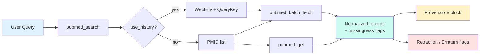

<p align="center">
  
</p>

<h1 align="center">pubmed-mcp</h1>

<p align="center">
  <strong>Research Guidelines Adjusted</strong><br/>
  Returns exactly what NCBI returns. Missing fields are flagged, never filled in.<br/>
  Built for evidence synthesis and systematic reviews.
</p>

<p align="center">
  <a href="https://pypi.org/project/pubmed-access-mcp/"></a>
  <a href="https://pypi.org/project/pubmed-access-mcp/"></a>
  <a href="LICENSE"></a>
  <a href="https://modelcontextprotocol.io"></a>
  <a href="https://github.com/ahsanmandhar-ui/pubmed-mcp/actions"></a>
</p>

---

## Why this exists

Most PubMed wrappers either invent missing metadata or bury the original NCBI response.  
This one does neither. Every field comes from the source. If PubMed left something out, you see it.  
That makes the output usable in PRISMA workflows and audit trails.

---

## Architecture


### Data flow (search → records)



---

## Install

```bash
pip install pubmed-access-mcp
```

Or run without installing:

```bash
uvx pubmed-access-mcp
```

---

## Tools at a glance

### Provenance & systematic-review tools

| Tool | What it does |
|------|--------------|
| `pubmed_get(pmid, mode="normalized")` | Single record. Normalized mode gives a fixed schema + missingness flags (`available` / `missing` / `not_returned_by_ncbi`) and notes any errata or retractions. Raw mode returns the original XML plus a SHA-256 hash. |
| `pubmed_search(query, max_results=20, ...)` | Search with a reproducibility block (original query, NCBI translation, count, timestamp) and optional Entrez History tokens. |
| `pubmed_fetch(pmids)` | Bulk fetch with per-record status and provenance. |
| `pubmed_batch_fetch(...)` | Large-scale retrieval. Handles long PMID lists or Entrez History in chunks of up to 200. |
| `pubmed_database_info(db="pubmed")` | NCBI EInfo: record counts, last update, field tags. |

### Access & PDF tools

| Tool | What it does |
|------|--------------|
| `search_pubmed(...)` | Lightweight search (PMIDs + query translation). |
| `fetch_abstracts(pmids)` | Classic record fetch (title, authors, journal, DOI, abstract, etc.). Up to 200 PMIDs. |
| `search_with_access(...)` / `check_access(pmids)` | Classify each hit: open-access PDF, landing page only, or none found. |
| `download_pdfs(pmids)` | Save verified open-access PDFs. Paywalled papers are skipped. |

---

## Guarantees

- Missing field → the string `"Data not provided in PubMed abstract"`. Nothing is inferred.
- PMIDs NCBI did not return appear in `not_found`.
- `publication_types` is NCBI’s own tag. No evidence grading (CEBM/GRADE) is added.
- Retraction flag is true only when NCBI itself lists a `RetractionIn` link.
- Rate limits are respected (3 req/s anonymous, 10 with API key) with exponential backoff.

---

## Open-access PDFs

Sources: Unpaywall (DOI) and PubMed Central (PMCID).  
Set `UNPAYWALL_EMAIL` or `NCBI_EMAIL`.  
`NO_OPEN_ACCESS_FOUND` means no legal free copy is indexed — it does not mean an institution cannot reach the paper.  
Every downloaded file is checked for a real `%PDF` header. Bot-check pages are rejected.  
Default folder: `~/pubmed_pdfs` (override with `PUBMED_PDF_DIR`). No paywall bypass.

---

## MCP client setup

### After `pip install`

```json
{
  "mcpServers": {
    "pubmed-scraper": {
      "command": "pubmed-access-mcp",
      "args": [],
      "env": {
        "NCBI_EMAIL": "you@example.com",
        "UNPAYWALL_EMAIL": "you@example.com"
      }
    }
  }
}
```

### With `uvx` (no install)

```json
{
  "mcpServers": {
    "pubmed-scraper": {
      "command": "uvx",
      "args": ["pubmed-access-mcp"],
      "env": {
        "NCBI_EMAIL": "you@example.com",
        "UNPAYWALL_EMAIL": "you@example.com"
      }
    }
  }
}
```

### OpenCode

```json
{
  "$schema": "https://opencode.ai/config.json",
  "mcp": {
    "pubmed-scraper": {
      "type": "local",
      "command": ["uvx", "pubmed-access-mcp"],
      "environment": {
        "NCBI_EMAIL": "you@example.com",
        "UNPAYWALL_EMAIL": "you@example.com"
      }
    }
  }
}
```

Optional env vars: `NCBI_API_KEY` (raises rate limit), `NCBI_TOOL`.  
Keep real keys in your global config, never in a committed file.

---

## Deploy (Google Cloud Run)

Free tier covers ~2 M requests/month with scale-to-zero.

```bash
export NCBI_EMAIL="you@example.com"
export UNPAYWALL_EMAIL="you@example.com"
export NCBI_API_KEY="your-key"   # optional

chmod +x deploy.sh
./deploy.sh                     # or ./deploy.sh my-project us-east1
```

After deploy the endpoint looks like:

```
https://pubmed-mcp-HASH-REGION.a.run.app/mcp
```

Point any MCP client that supports remote servers at that URL.

One-click public tunnel (Windows):

```bat
run_cloudflare_tunnel.bat
```

---

## Development

```bash
git clone https://github.com/ahsanmandhar-ui/pubmed-mcp.git
cd pubmed-mcp
python -m venv .venv && source .venv/bin/activate
pip install -r requirements.txt

python tests/test_server.py   # offline
python tests/test_access.py
```

---

## Limitations

- Abstracts only. Full text is not returned (unless the paper is in the PMC open-access subset and you download the PDF).
- Search quality depends on your query. Always check `query_translation`.
- Open-access coverage varies; some publishers block automated downloads.
- Live network behaviour is not covered by the offline test suite.

---

## License

Apache License 2.0 — see `LICENSE`.  
Copyright © ahsanmandhar-ui.