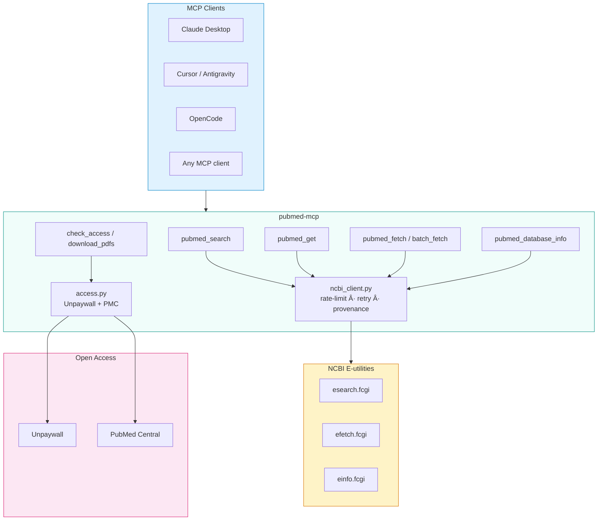
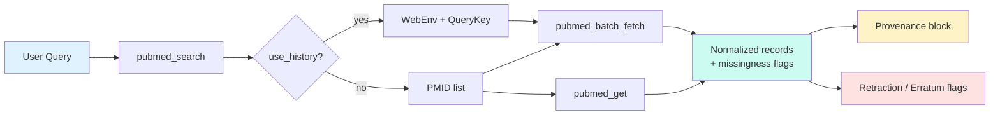

<p align="center">
  
</p>

<h1 align="center">pubmed-mcp</h1>

<p align="center">
  <strong>Minimal MCP server for PubMed</strong><br/>
  Returns exactly what NCBI returns. Missing fields are flagged, never filled in.<br/>
  Built for evidence synthesis and systematic reviews.
</p>

<p align="center">
  <a href="https://pypi.org/project/pubmed-access-mcp/"></a>
  <a href="https://pypi.org/project/pubmed-access-mcp/"></a>
  <a href="LICENSE"></a>
  <a href="https://modelcontextprotocol.io"></a>
  <a href="https://github.com/ahsanmandhar-ui/pubmed-mcp/actions"></a>
</p>

---

## Why this exists

Most PubMed wrappers either invent missing metadata or bury the original NCBI response.  
This one does neither. Every field comes from the source. If PubMed left something out, you see it.  
That makes the output usable in PRISMA workflows and audit trails.

---

## Architecture



### Data flow (search → records)



---

## Guarantees

| Guarantee | Meaning |
|-----------|---------|
| **Source fidelity** | Every field comes directly from the NCBI E-utilities response. Nothing is inferred, guessed, paraphrased, or enriched from external sources. |
| **Missingness flagged** | A field PubMed does not provide is returned as the literal string `"Data not provided in PubMed abstract"` — never fabricated. |
| **Not-found reported** | PMIDs requested but not returned by NCBI are listed in `not_found`, never silently dropped or fabricated. |
| **Provenance on every record** | Each normalized record carries a `provenance` block marking every field as `directly_sourced` or `not_returned_by_ncbi`. |
| **Anti-inference** | `false_inference_count == 0` — verified by the offline regression benchmark (`benchmark.py`). |
| **No paywall bypass** | Only legally open-access copies (PubMed Central, Unpaywall gold/green) are indexed and downloaded. |
| **Stdout reserved for MCP** | In stdio mode, stdout is reserved for the MCP protocol; all logging goes to stderr. |

### What this is not

- No full-text extraction beyond legally open PDFs
- No evidence-level grading (CEBM/GRADE) added
- No silent enrichment from Crossref, OpenAlex, Semantic Scholar, or other databases
- No paywall bypass
- No LLM-based abstract completion or metadata inference

---

## Install

```bash
pip install pubmed-access-mcp
```

Or run without installing:

```bash
uvx pubmed-access-mcp
```

---

---

## Tools grouped by phase / purpose

### Phase 1 — Evidence provenance & search snapshots

| Tool | What it does |
|------|--------------|
| `pubmed_database_info` | NCBI einfo for a database (field list, counts, last update). |
| `pubmed_create_search_snapshot` | Save a search query + parameters as a named snapshot for reproducible retrieval. |
| `pubmed_get_snapshot` | Retrieve a previously created search snapshot by ID. |
| `pubmed_list_snapshots` | List existing snapshots (paginated). |

### Phase 2 — Bibliographic exports & download audit

| Tool | What it does |
|------|--------------|
| `pubmed_export_ris` | Export records in RIS format (reference managers). |
| `pubmed_export_bibtex` | Export records in BibTeX format. |
| `pubmed_export_csv` | Export records as CSV. |
| `pubmed_export_json` | Export records as JSON. |

### Phase 3 — Source-linked structured evidence tables

| Tool | What it does |
|------|--------------|
| `pubmed_evidence_table` | Build a structured evidence table from records or a snapshot. Every cell carries value + status + optional source quote. |

### Phase 4 — Europe PMC, deduplication, citation chase, retraction monitoring

| Tool | What it does |
|------|--------------|
| `europe_pmc_search` | Search Europe PMC (complementary to PubMed). |
| `europe_pmc_get` | Fetch a single Europe PMC record by ID. |
| `pubmed_deduplicate` | Deduplicate records by PMID / DOI / title matching. |
| `pubmed_citation_chase` | Trace citations forward/backward for a set of PMIDs. |
| `pubmed_retraction_check` | Check PMIDs for retraction / erratum notices via NCBI link data. |

### Phase 5 — Offline evaluation & regression benchmark

| Tool | What it does |
|------|--------------|
| `pubmed_validate` | Validate a normalized record against the anti-inference guarantee; returns `false_inference_count`. |

### Core retrieval tools (all phases)

| Tool | What it does |
|------|--------------|
| `pubmed_search` | Search PubMed via NCBI esearch. Returns PMIDs, total match count, query translation, and Entrez History tokens (`webenv` / `query_key`) when `use_history=True`. |
| `pubmed_get` | Fetch a single normalized record by PMID, with full provenance. |
| `pubmed_fetch` | Fetch multiple PMIDs in one call (internally chunked, max 200 per chunk). |
| `pubmed_batch_fetch` | Retrieve large result sets via PMID list or Entrez History, chunked at `batch_size` (max 200). |

---

## Retrieving full result sets (> 200 records)

`pubmed_search` returns at most `max_results` PMIDs per call (default 20, capped at `MAX_SEARCH = 9999`). To retrieve all matching records when `total_matches` exceeds that:

```python
# Step 1: Search with Entrez History enabled
result = server.pubmed_search(
    query="your PubMed query",
    use_history=True,        # stores search on NCBI Entrez History server
    max_results=200,         # or higher, up to 9999
)

total_matches = result["search"]["count"]      # total matching records
webenv = result["webenv"]                       # Entrez WebEnv token
query_key = result["query_key"]                 # Entrez QueryKey token

# Step 2: Batch-fetch all records in chunks of 200
all_records = server.pubmed_batch_fetch(
    webenv=webenv,
    query_key=query_key,
    total_records=total_matches,
    batch_size=200,         # max 200 per chunk
)
```

`pubmed_batch_fetch` iterates `retstart` from 0 to `total_records` in chunks of `batch_size`, returning per-batch results, per-record statuses, and `not_found` PMIDs.

---


## Examples

Runnable, copy-pasteable snippets for real workflows. No secrets, no real API
keys, no emails — every file uses placeholders only.

| Example | Description |
|---------|-------------|
| [examples/SYSTEMATIC_REVIEW_EXAMPLE.md](examples/SYSTEMATIC_REVIEW_EXAMPLE.md) | Full-retrieval pattern for systematic reviews: pubmed_search(use_history=True) → pubmed_batch_fetch(...). Covers the E. coli × tetracycline × MGE × 2000–2025 protocol query. |
| [examples/LIVE_SMOKE_EXAMPLE.md](examples/LIVE_SMOKE_EXAMPLE.md) | Minimal end-to-end smoke test: search → normalized single record → anti-inference benchmark check. |

Each example declares the anti-inference guarantee (alse_inference_count == 0)
and documents provenance statuses (directly_sourced / 
ot_returned_by_ncbi).
## Open-access PDFs

Sources: Unpaywall (DOI) and PubMed Central (PMCID).  
Set `UNPAYWALL_EMAIL` or `NCBI_EMAIL`.  
`NO_OPEN_ACCESS_FOUND` means no legal free copy is indexed — it does not mean an institution cannot reach the paper.  
Every downloaded file is checked for a real `%PDF` header. Bot-check pages are rejected.  
Default folder: `~/pubmed_pdfs` (override with `PUBMED_PDF_DIR`). No paywall bypass.

---

## MCP client setup

### After `pip install`

```json
{
  "mcpServers": {
    "pubmed-scraper": {
      "command": "pubmed-access-mcp",
      "args": [],
      "env": {
        "NCBI_EMAIL": "you@example.com",
        "UNPAYWALL_EMAIL": "you@example.com"
      }
    }
  }
}
```

### With `uvx` (no install)

```json
{
  "mcpServers": {
    "pubmed-scraper": {
      "command": "uvx",
      "args": ["pubmed-access-mcp"],
      "env": {
        "NCBI_EMAIL": "you@example.com",
        "UNPAYWALL_EMAIL": "you@example.com"
      }
    }
  }
}
```

### OpenCode

```json
{
  "$schema": "https://opencode.ai/config.json",
  "mcp": {
    "pubmed-scraper": {
      "type": "local",
      "command": ["uvx", "pubmed-access-mcp"],
      "environment": {
        "NCBI_EMAIL": "you@example.com",
        "UNPAYWALL_EMAIL": "you@example.com"
      }
    }
  }
}
```

Optional env vars: `NCBI_API_KEY` (raises rate limit), `NCBI_TOOL`.  
Keep real keys in your global config, never in a committed file.

---

## Deploy (Google Cloud Run)

Free tier covers ~2 M requests/month with scale-to-zero.

```bash
export NCBI_EMAIL="you@example.com"
export UNPAYWALL_EMAIL="you@example.com"
export NCBI_API_KEY="your-key"   # optional

chmod +x deploy.sh
./deploy.sh                     # or ./deploy.sh my-project us-east1
```

After deploy the endpoint looks like:

```
https://pubmed-mcp-HASH-REGION.a.run.app/mcp
```

Point any MCP client that supports remote servers at that URL.

One-click public tunnel (Windows):

```bat
run_cloudflare_tunnel.bat
```

---

## Development

```bash
git clone https://github.com/ahsanmandhar-ui/pubmed-mcp.git
cd pubmed-mcp
python -m venv .venv && source .venv/bin/activate
pip install -r requirements.txt

python tests/test_server.py   # offline
python tests/test_access.py
```

---

## Limitations

- Abstracts only. Full text is not returned (unless the paper is in the PMC open-access subset and you download the PDF).
- Search quality depends on your query. Always check `query_translation`.
- Open-access coverage varies; some publishers block automated downloads.
- Live network behaviour is not covered by the offline test suite.

---

## License

Apache License 2.0 — see `LICENSE`.  
Copyright © ahsanmandhar-ui.
